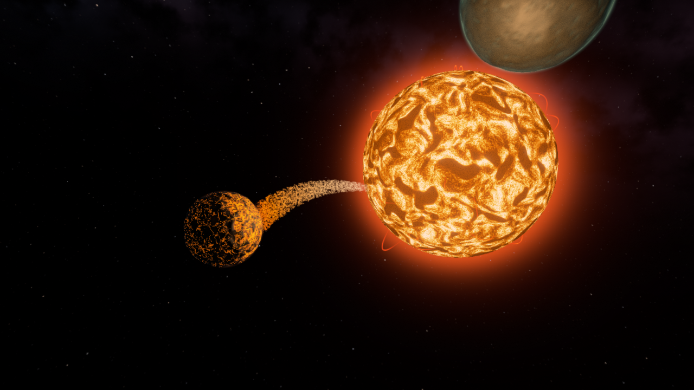
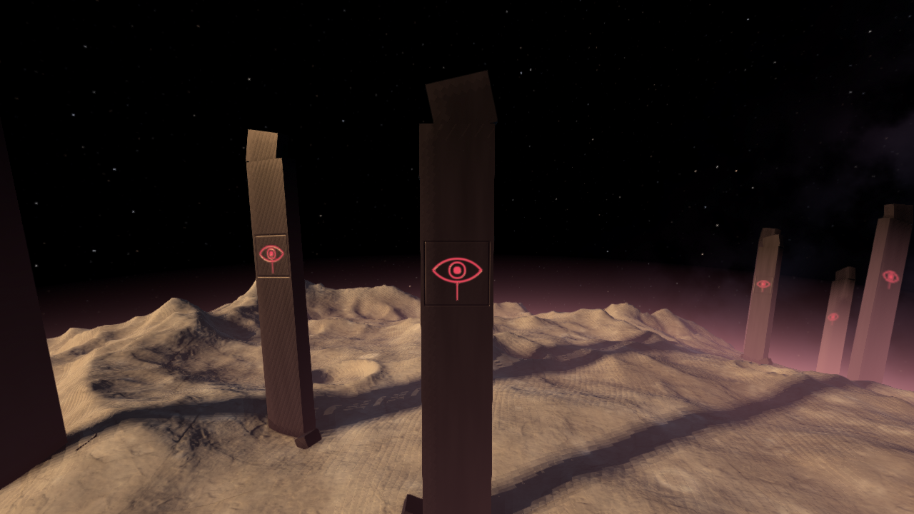
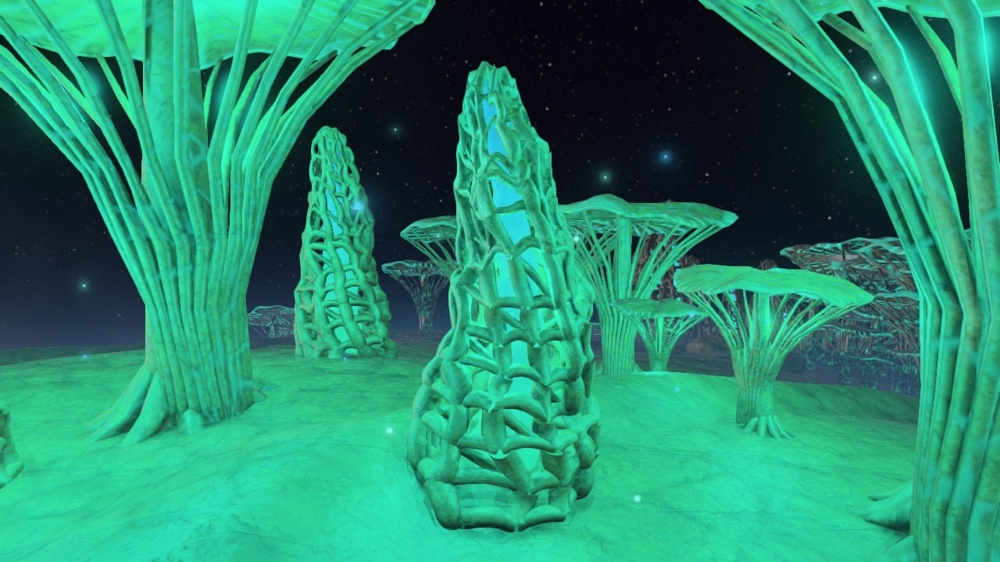

# OCASO

Gráficas por Computadora · Proyecto 3 · Lázaro Díaz, 24713

Un sistema solar explorable en nave, dibujado con un renderer por software
propio en CPU. **Ocaso**, una supergigante roja, agoniza y late como un
corazón. Durante quince minutos se puede volar entre sus cinco planetas;
después su latido se acelera, colapsa en una supernova fallida y en su lugar
queda **Gargantúa**, un agujero negro con su disco de acreción, que curva la
luz de todo el cielo. Luego el ciclo vuelve a empezar.


| | |
| --- | --- |
|  |  |
|  |  |
|  |  |

## Video

El repositorio incluye [el recorrido continuo](media/recorrido-continuo.mp4): vuelo, acercamiento, una vuelta
completa a Jardin y alejamiento, sin cambiar de escena. El piloto usa la misma
fisica del vuelo manual. Se exporta a 24 fps con la simulacion acelerada x3;
no es una medicion de FPS en tiempo real. El colapso se puede mostrar con J.

Recorrido sugerido para grabarlo (F9 oculta el HUD):

1. Desde el inicio, junto a Pira, alejarse con Shift para ver el chorro de
   brasas cayendo a la estrella.
2. Volar a Jardín y bajar hasta la superficie: el modo local se activa solo.
3. Con O (crucero), dar la vuelta al planeta sobre el bosque de hongos.
4. Subir y alejarse con Shift.
5. J para ir a 20 s antes del colapso: la arritmia, el destello, la onda
   gravitacional y Gargantúa formando su disco.

## Ejecutar

Se necesita Rust (edición 2024) y CMake, que usa `raylib` para compilarse.

```sh
cargo run --release
```

Opciones:

```sh
cargo run --release -- --res 1920x1080        # resolución del render (por defecto 1280x720)
cargo run --release -- --captura capturas     # las 25 vistas fijas como PNG, sin abrir ventana
cargo run --release -- --bench 30             # mide cada vista fija y da medianas por etapa
cargo run --release -- --wire --lod           # empieza con wireframe y colores de LOD
cargo test --release                          # pruebas de vuelo, raster, sombras y gas volumétrico
```

## Controles

| Acción | Control |
| --- | --- |
| Apuntar (la nave gira hacia la mira) | Mouse |
| Mirar alrededor sin girar la nave | Clic derecho sostenido |
| Adelante / atrás, lados | W / S, A / D |
| Subir / bajar | Espacio / Ctrl |
| Alabeo | Q / E |
| Turbo | Shift |
| **Freno de emergencia** (prioridad sobre turbo y crucero) | **X sostenida** |
| **Recuperar posicion** junto a Pira, conservando el ciclo | **Inicio / Home** |
| Acercar / alejar la cámara | Rueda |
| Cámara de persecución / cabina | C |
| Asistente de vuelo / gravedad | Z / G |
| **Modo local** (vuelo relativo a la superficie) | L |
| **Crucero**: rodea el planeta solo | O |
| Trayectoria predicha (auto / siempre / nunca) | V |
| Rebobinar el tiempo | R sostenido |
| Saltar 30 s atrás / adelante en el ciclo | [ / ] |
| Ir a 20 s antes del colapso | J |
| Recorrer las vistas fijas (las mismas de `--captura`) | AvPág / RePág |
| **Ajustes en vivo** (radio, órbita, semilla, shaders...) | T, flechas y Shift |
| Wireframe / colores de LOD / LOD encendido | F3 / F4 / F5 |
| Otra semilla para los objetos de la superficie | F6 |
| Congelar el frustum (ver el culling desde afuera) | F7 |
| Silenciar | M |
| Foto en `capturas/` | P |
| Soltar o capturar el mouse | Tab |
| Ayuda / estadísticas / ocultar todo el HUD | F1 / F2 / F9 |
| Salir | Esc |


## Revision visual y vuelo

En Windows se puede abrir `Jugar_OCASO.cmd`; en el paquete lleva el ejecutable,
y en el repositorio compila con Cargo si no lo encuentra. Los controles completos
se muestran con F1; F2 abre contadores y F9 oculta el HUD.

- OCASO-1: 78.057, 24.977 y 6.243 triangulos segun distancia.
- Jardin: hongos con nervaduras y torres abiertas con nucleos luminosos;
  suelo con normales triplanares, cavidades y arterias animadas. El bioma
  de llegada tiene colonias a ambos lados de un claro, colocadas sobre el
  terreno; giran con el planeta y se pueden visitar en vuelo libre.
- Cielo con estrellas mas finas y nebulosa; estrella roja con conveccion;
  Gargantua con la Variante dorada y las nubes grises del Proyecto 2.
- Orbitas mas cercanas para reducir los viajes y hacer visibles los vecinos.
- Velocidad normal limitada a 420 u/s, turbo a 1.092 u/s; el frenado conserva
  autoridad al bajar la velocidad de aproximacion. Con asistencia, soltar las
  teclas detiene la nave; X tambien funciona sin asistencia.
- La franja exterior impide escapar indefinidamente. Inicio/Home recupera una
  posicion segura: es una ayuda del piloto, no parte del recorrido evaluado.

Vistas nuevas, accesibles tambien con AvPag/RePag:

```sh
cargo run --release -- --vista 22_agonia
cargo run --release -- --vista 23_jardin_biopunk
cargo run --release -- --vista 24_el_ojo
cargo run --release -- --captura capturas --vista 23_jardin_biopunk --res 1600x900
cargo run --release -- --recorrido recorrido-continuo.mp4 --res 960x540
```

La grabacion necesita `ffmpeg` en PATH o la variable `OCASO_FFMPEG` apuntando
a su ejecutable. El juego manual y las capturas PNG no lo necesitan.
Para regenerar la nave: `blender --background --python tools/export_ship.py`.
Se exportan geometría, UV, normales y los parámetros de los materiales;
la iluminación se calcula con los shaders propios de Rust.

## Qué evaluar y dónde verlo

Las vistas fijas se generan con `--captura` (nombres entre paréntesis).

| Característica del menú | Cómo está hecho | Dónde verlo |
| --- | --- | --- |
| **5 planetas** que orbitan, rotan y se ven de cerca (50) | Pira (mundo de lava con acoplamiento de marea, la estrella se la come), Jardín (mundo vivo que respira, con venas que laten), Vigía (gigante gaseoso con una tormenta-ojo que sigue a la nave), Réquiem (necrópolis helada) y Cementerio (cráteres y zanjas de naves estrelladas, con anillos). Órbitas y giros son funciones del tiempo. | (02) a (08); volar a cualquiera |
| **6 tipos de modelos** propios en la superficie (20) | Monolito con un ojo tallado, obelisco, hongo bioluminiscente, coral, espinas de obsidiana y nave náufraga, armados con código en `scene/props.rs`, cada uno en tres niveles de detalle. | (10) a (13), (20) |
| **Distribución procedural** reproducible con ruido (10) | Una grilla por cara del cubo-esfera; cada celda propone un punto y lo acepta con una probabilidad de ruido fBm (grupos y claros) por las reglas del terreno (pendiente, hielo, lava, valles). Misma semilla, mismas ubicaciones. | F6 o T → semilla |
| **Posición y orientación** sobre la superficie curva que gira (5) | Cada objeto vive en el espacio de su planeta, parado sobre la normal radial y hundido en el suelo; gira con el planeta y sube y baja con la respiración de Jardín. | Cualquier superficie |
| **Shaders propios** distintos (24) | Estrella (convección y latido), lava de cuerpo negro de Pira, venas y poros de Jardín, bandas y ojo de Vigía, hielo de Réquiem, chatarra de Cementerio, anillos con sombras, objetos, Gargantúa. | Todas las vistas |
| **Shader animado** (8) | El latido de la estrella (que se acelera en el ciclo), la lava que fluye, Jardín que respira, el ojo de Vigía, el gas del disco. | (02), (04), (06), (18) |
| **Mapeo de normales** (8) | Mapas generados al arrancar (el glifo del ojo y las placas del casco) con mipmaps; tangentes por vértice y base TBN por pixel. | (10), (13) |
| **Deformación de la geometría** con ruido (10) | Las funciones de altura de cada planeta desplazan los vértices del cubo-esfera (cráteres, crestas, mares de lava, zanjas); Jardín además respira en el vertex shader. | Todas; `--wire` |
| **Generación de geometría** propia antes de rasterizar (10) | Quadtree de chunks del cubo-esfera generados en paralelo con faldones, icosfera por subdivisión, modelos con `MeshBuilder`, cintas para líneas, recorte de Sutherland-Hodgman. | F3, F4 |
| **Modo de control local** (8) | Cerca de un planeta (L) el vuelo se mide contra su superficie que gira: la mira se nivela con la vertical del planeta y se transporta con la curvatura, la nave sostiene sola su altura sobre el terreno y el crucero (O) rodea el planeta. | L, O |
| **Aceleración, frenado y giro progresivos** (8) | Física a paso fijo de 120 Hz con interpolación: igual a 30 o a 300 fps. El asistente pide velocidades con aceleración limitada; el giro persigue la mira con aceleración angular limitada. | Volar |
| **Gravedad** que curva la trayectoria (10) | Gravedad del cuerpo dominante (G la apaga). Sin asistente (Z) se ve la trayectoria predicha (V), integrada con la misma física, con aviso de choque. | (15) |
| **Colisión** con el planeta (4) | Contra la misma función de altura que se dibuja; la cámara tampoco entra al terreno. | Bajar a la superficie |
| **Descarte** antes de rasterizar (7) | Esferas contra el frustum por objeto, chunks detrás del horizonte o fuera del frustum, objetos demasiado chicos, caras traseras. Contadores en el HUD (F2) y frustum congelado (F7). | F2, F7, (21) |
| **Niveles de detalle** (8) | Terreno por distancia (quadtree) y objetos por tamaño en pantalla (3 niveles, se encogen al desaparecer). F4 colorea los niveles; F5 apaga el LOD y el HUD muestra cuántos triángulos más cuesta. | F4, F5 |
| **Presentación** (10) | Dirección de arte deliberada (el ciclo de OCASO), HUD con nombres de los cuerpos, ayuda (F1) y controles explicados. | — |

Además, fuera del menú:

- **Gargantúa** ([src/shaders/gargantua.rs](src/shaders/gargantua.rs)): la física de mi Proyecto 2 (geodésicas de Schwarzschild, Doppler y corrimiento gravitacional, disco delgado) usada de otra forma: se integra una tabla de mil rayos con RK4 (se rehace cuando cambia la distancia de la cámara al agujero) y cada pixel la consulta en vez de integrar su propio rayo. Se ven la sombra, el disco de atrás doblado por encima y por debajo, los anillos de fotones y las estrellas curvadas.
- **El ciclo** ([src/scene/cycle.rs](src/scene/cycle.rs)): una función pura del tiempo, por eso se puede rebobinar.
- **Atmósferas** con dispersión de Rayleigh y Mie, perspectiva aérea por vértice y una tabla del cielo cuando la cámara está adentro.
- **Partículas** aditivas con profundidad: el chorro de brasas que Pira pierde, esporas que brillan de noche, el fuego de los motores.
- **Sonido sintetizado**: el latido sincronizado con el que se ve, motor, viento y un tono por planeta.
- **Bloom** y tonemap HDR que conserva el tono.

## En la demostración: cambiar parámetros en vivo

El panel T cambia, mientras el juego corre, el radio de un planeta (se
regeneran su terreno, su atmósfera y sus objetos), su periodo orbital o de
giro (sin saltos: se corrige la fase), la intensidad del efecto de su shader,
la semilla de los objetos, el latido de la estrella, la exposición, el bloom
y el factor de LOD.

## Cómo funciona

```text
dibujos (malla + matriz + material)
 -> culling por objeto: esfera envolvente contra el frustum
 -> vértices: deformación, objeto -> mundo relativo a la cámara -> clip,
    atmósfera por vértice                                           (paralelo)
 -> triángulos: descarte, recorte, setup y reparto en tiles        (paralelo)
 -> mapa de sombras ortográfico 1024x1024                         (CPU)
 -> raster por tiles de 64x64 al visibility buffer                (paralelo)
 -> barrera: se completa toda la profundidad antes de leer vecinos
 -> shading diferido: PBR, PCF, oclusión ambiental de pantalla      (paralelo)
 -> Gargantúa volumétrico, anillos, atmósferas y partículas         (paralelo)
 -> reflejos de pantalla en superficies mojadas cercanas           (paralelo)
 -> bloom y tonemap HDR -> RGBA8 -> textura de raylib               (paralelo)
```

- Profundidad invertida en `f32` con el plano lejano en el infinito; el
  mundo se guarda en `f64` y se dibuja relativo a la cámara.
- Un pool de hilos propio con reparto dinámico (el i5-12500H tiene núcleos
  de dos tamaños).
- Esta revision prioriza detalle visual. El costo depende mucho de la vista:
  medir con `--bench 10`. El paquete incluye `rendimiento.txt` con mediciones
  del i5-12500H a 1280x720. Los primeros frames de carga no se miden.
- FXAA en CPU suaviza las diagonales despues del tonemap; F3/F4 lo omiten
  para mantener legibles las aristas y los colores de depuracion.

| Carpeta | Contenido |
| --- | --- |
| [src/render](src/render) | Pipeline: vértices, recorte, raster en punto fijo, shading diferido, partículas, bloom, tonemap y PNG |
| [src/shaders](src/shaders) | Shaders de la estrella, los planetas, los objetos, la nave, el cielo, las atmósferas, los anillos y Gargantúa; mapas de normales |
| [src/terrain](src/terrain) | Cubo-esfera con quadtree, LOD, faldones y las funciones de altura de cada planeta |
| [src/scene](src/scene) | Cuerpos celestes, ciclo, objetos de la superficie, física de la nave, trayectoria, partículas, cámara y lector OBJ |
| [src/math](src/math) | Vectores, matrices, cuaterniones, ruido, cuerpo negro, relatividad y la tabla de geodésicas |
| [src/audio.rs](src/audio.rs) | Sintetizador del sonido |
| [src/tweaks.rs](src/tweaks.rs) | Panel de ajustes en vivo |
| [src/parallel.rs](src/parallel.rs) | Pool de hilos persistentes |


### Materiales y luz de esta revisión

La nave usa los colores, texturas empacadas, rugosidad y metalicidad del
Blender original. La BRDF Cook–Torrance combina GGX, Smith y Fresnel de
Schlick. Se añaden sombras PCF y oclusión ambiental, fotografías de roca con
normales triplanares, luces locales bajo los hongos y reflejos de pantalla
en el suelo húmedo. Las luces locales y los reflejos son aproximaciones;
los reflejos solo pueden recuperar lo que está visible en el framebuffer.

Gargantúa conserva el medio **Variante** del Proyecto 2: pico de 6500 K,
disco caliente de 3 a 13 rs y envoltura gris hasta 19 rs. Los rayos que
atraviesan gas integran su espesor, absorción y emisión con el RK4 original;
el campo cilíndrico tiene 384×192×9 muestras, dos capas de flujo y rotación
kepleriana. Se conserva el Doppler y la curva de exposición del Proyecto 2.
La tabla de geodésicas acelera el cielo lejano. La vista `24_el_ojo` usa
la elevación de 2°, distancia de 21.5 rs y FOV de 34° de la vista original.
El cielo y los planetas pertenecen al sistema del Proyecto 3.

El perfil predeterminado prioriza detalle visual, también por debajo de
30 FPS. `ms_total` mide el frame completo de la app, incluyendo terreno,
sombras, actualización del gas y dibujo. El coste de carga inicial se
separa con calentamiento. Gargantúa volumétrico es la vista más costosa;
la resolución se puede bajar con `--res 960x540`.

Para reexportar la nave con Blender 5.2:

```powershell
& 'C:\Program Files\Blender Foundation\Blender 5.2\blender.exe' --background --python tools/export_ship.py
```

El exportador también escribe `ship-materials.txt` y sus seis mapas RGB8.
Las imágenes se leen, filtran y muestrean en Rust; no se usan texturas 3D
ni shaders de GPU. El archivo `.rgb` contiene ancho y alto `u32` LE,
seguidos por tres bytes RGB por pixel. Solo los mapas de color se decodifican
desde sRGB; normal, rugosidad y AO permanecen lineales.

## Integrantes y contribuciones

Trabajo individual: Lázaro Díaz (24713). Se utilizo asistencia de IA para
modelado, implementacion, mejoras visuales y depuracion. El estudiante debe
revisar y poder explicar el codigo y las decisiones de la entrega.

## Dependencias, recursos y asistencia

- La única dependencia es `raylib`, usada solo para la ventana, la entrada,
  mostrar el framebuffer como textura, el texto 2D del HUD y reproducir el
  sonido que genera el sintetizador. No se usa ninguna de sus funciones 3D,
  de modelos, cámara, materiales, shaders ni física.
- Reutilizo código propio: el pool de hilos, el color de cuerpo negro, la
  curva de tonemap, el bloom y la relatividad de Gargantúa vienen de mi
  Proyecto 2; el lector OBJ parte del lab 4.
- La nave OCASO-1 se creo para este proyecto en Blender con asistencia de IA
  a partir de las referencias aportadas. Su fuente esta en `assets/source/`.
  El exportador conserva UV, normales, materiales PBR y tres niveles de detalle.
  Dos láminas de efectos transparentes (campo anular y HUD holográfico) se
  excluyen del modelo opaco: evitamos que tapen el reactor como discos sólidos.
  El Blender fuente se conserva. El render, el terreno, los objetos, la
  animación del gas, el cielo y el sonido se calculan en CPU.
- Las fotografías de Júpiter y la Luna provienen de NASA; el basalto usa
  Rock Face 03 de Poly Haven (CC0). Créditos y enlaces en
  [assets/textures/FUENTES.txt](assets/textures/FUENTES.txt).
- Se usó asistencia de IA durante el desarrollo.
